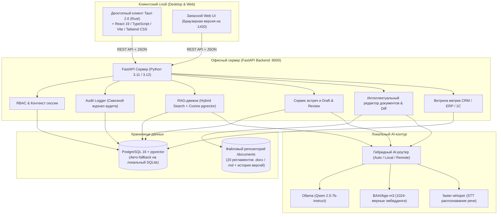

# Программный комплекс «Локальный AI-ассистент руководителя» (PhotoPrint-AI-Assistant)
### Корпоративный On-Premise ассистент топ-менеджмента ООО «Фотопринт» (сервис picPac.by)

[](https://www.python.org/)
[](https://fastapi.tiangolo.com/)
[](https://tauri.app/)
[](https://react.dev/)
[](https://github.com/pgvector/pgvector)
[](https://ollama.com/)
[](#1-общие-сведения-и-цель-проекта)
[](https://github.com/ZoVD/PhotoPrint-AI-Assistant)

---

## 📑 Оглавление
1. [Общие сведения и цель проекта](#1-общие-сведения-и-цель-проекта)
2. [Ключевые принципы безопасности и AI-требования ТЗ](#2-ключевые-принципы-безопасности-и-ai-требования-тз)
3. [Роли пользователей и матрица доступа (RBAC)](#3-роли-пользователей-и-матрица-доступа-rbac)
4. [Архитектура и стек технологий](#4-архитектура-и-стек-технологий)
5. [Реализованные функциональные сценарии (Трек 3)](#5-реализованные-функциональные-сценарии-трек-3)
6. [Установка и запуск (Installation & Quick Start)](#6-установка-и-запуск-installation--quick-start)
   - [6.1. Быстрый запуск в 1 клик (Windows)](#61-быстрый-запуск-в-1-клик-windows)
   - [6.2. Развертывание базы данных через Docker Compose](#62-развертывание-базы-данных-через-docker-compose)
   - [6.3. Пошаговый ручной запуск (Windows / Linux / macOS)](#63-пошаговый-ручной-запуск-windows--linux--macos)
   - [6.4. Автоматический выбор СУБД (PostgreSQL 16 vs SQLite)](#64-автоматический-выбор-субд-postgresql-16-vs-sqlite)
   - [6.5. Маршрутизация и диагностика нейросетей (AI Routing)](#65-маршрутизация-и-диагностика-нейросетей-ai-routing)
7. [Конфигурация и переменные окружения (.env)](#7-конфигурация-и-переменные-окружения-env)
   - [7.1. Параметры бэкенда (`backend/.env`)](#71-параметры-бэкенда-backenedenv)
   - [7.2. Параметры фронтенда (`desktop/.env`)](#72-параметры-фронтенда-desktopenv)
   - [7.3. Сводная таблица переменных окружения](#73-сводная-таблица-переменных-окружения)
8. [Синтетический датасет и эталонные данные](#8-синтетический-датасет-и-эталонные-данные)
9. [Сценарий презентации и демо для жюри (Регламент 3 минуты)](#9-сценарий-презентации-и-демо-для-жюри-регламент-3-минуты)
10. [Результаты тестирования и бенчмарки качества AI](#10-результаты-тестирования-и-бенчмарки-качества-ai)
11. [Спецификация REST API эндпоинтов](#11-спецификация-rest-api-эндпоинтов)
12. [Структура репозитория](#12-структура-репозитория)

---

## 1. Общие сведения и цель проекта

### 1.1. Наименование системы
Программный комплекс **«AI-ассистент руководителя ООО „Фотопринт“»** (**PhotoPrint-AI-Assistant**), разработанный в рамках **Трека 3** хакатона «Единая система управления компанией».

### 1.2. Назначение системы
Автономный защищенный корпоративный ассистент для генерального директора и руководителей функциональных подразделений компании «Фотопринт» (производитель фотокниг и полиграфии, сервис picPac.by). Комплекс решает задачи:
- автоматизации подготовки повесток и протоколирования совещаний;
- интеллектуального извлечения поручений, ответственных, дедлайнов и рисков из аудиозаписей и стенограмм;
- семантического RAG-поиска по регламентам, стандартам качества и финансовым документам компании;
- мониторинга оперативного управленческого пульса (KPI производства, SLA поддержки, финансовые срезы);
- контроля исполнительской дисциплины по регламенту Human-in-the-Loop;
- версионирования нормативных документов и AI-генерации черновиков изменений с визуальным Diff.

### 1.3. Ключевой принцип (On-Premise & Data Sovereignty)
Система развертывается и функционирует **строго внутри локального защищенного контура предприятия**.  
Коммерческая тайна, производственные ноу-хау, сетки окладов и персональные данные сотрудников **ни при каких условиях не покидают периметр организации и не отправляются в публичные облачные API**. Все нейросетевые модели (LLM, Embeddings, STT) работают локально либо в доверенном изолированном контуре.

---

## 2. Ключевые принципы безопасности и AI-требования ТЗ

Реализация полностью удовлетворяет требованиям ТЗ:

* **AI-01 (Трассируемость источников)**: Каждый ответ ассистента по корпоративным данным обязательно сопровождается ссылкой на исходный документ, дату редакции и точную цитату-первоисточник.
* **AI-02 (RBAC в RAG и генерации)**: Полнотекстовый и векторный поиск учитывают уровень допуска текущего пользователя (`Clearance Level`). Документы с повышенным уровнем допуска отсекаются **на уровне SQL-запроса к базе данных до передачи в LLM**. Закрытые данные физически не могут попасть в контекст модели, а попытки доступа логируются со статусом `ACCESS_DENIED`.
* **AI-03 (Human-in-the-Loop & Draft and Review)**: Автоматическая постановка задач в реестр, изменение регламентов и назначение встреч требуют **явного подтверждения человеком** («Подтвердить и внести в реестр»). При отмене состояние системы не изменяется.
* **AI-04 (Классификация решений протокола)**: Протокол встречи структурирует итоги по 4 обязательным категориям:
  1. `«Решено»` (`resolved`) — утвержденные решения;
  2. `«Предложено»` (`proposed`) — идеи и предложения;
  3. `«Обсуждалось»` (`discussed`) — обсужденные темы и контекст;
  4. `«Требует уточнения»` (`needs_clarification`) — нерешенные вопросы.
  Дополнительно выявляются технологические, финансовые и операционные риски с таймкодами.
* **AI-05 (Антигаллюцинация)**: Если в стенограмме не назван ответственный или срок, модели **запрещено додумывать информацию**. Поле маркируется статусом `«требует уточнения»`. Если в регламентах нет ответа, ассистент прямо сообщает об отсутствии данных.
* **AI-06 (Сквозной журнал аудита безопасности)**: Все операции пользователей и системы логируются с меткой времени UTC+3, указанием роли, действия, объекта и статуса.
* **AI-07 (Интерактивное редактирование)**: Руководитель может скорректировать любое поле (формулировку, срок, исполнителя) перед утверждением.
* **Защита от Prompt Injection**: Контекст документов экранируется в строгие XML-теги `<untrusted_context>`. Любые попытки переопределения инструкций игнорируются системным промптом.

---

## 3. Роли пользователей и матрица доступа (RBAC)

В системе реализована трехуровневая ролевая модель доступа:

| Идентификатор роли | Наименование роли | Допуск (Clearance) | Доступные документы и функции | Ограничения доступа (Блокировка) |
| :--- | :--- | :---: | :--- | :--- |
| `ROLE_DIRECTOR` | **Генеральный директор**<br>*(Смирнов А.В.)* | **1 (Полный)** | Финансовая отчетность (БДР, БДДС, P&L, маржинальность), оклады топ-менеджмента, стратегия, договоры, все протоколы, задачи и сводки KPI. | Ограничений нет. |
| `ROLE_PRODUCTION_HEAD` | **Начальник производства**<br>*(Иванов И.С.)* | **2 (Производство)** | Технологические карты оборудования (HP Indigo 7900, ламинатор Foliant Vega), регламенты цеха, нормы брака, сменные графики, протоколы планерок. | **Строго закрыты**: финансовые балансы, фонды оплаты труда, персональные зарплаты руководства, инвестиционные планы. |
| `ROLE_SUPPORT_HEAD` | **Руководитель клиентского сервиса**<br>*(Ковалева Е.Д.)* | **3 (Сервис)** | Регламенты обработки претензий PicPac.by, стандарты SLA, правила перепечатки и возвратов, промокоды, статистика обращений клиентов. | **Строго закрыты**: технологические спецификации станков цеха, финансовые отчеты компании, закрытые кадровые данные. |

> **Для презентации жюри**: В верхней панели интерфейса расположен быстрый переключатель между тремя ролями, а также кнопка **«Сбросить демо к эталону»** (возвращает БД и документы к начальному состоянию).

---

## 4. Архитектура и стек технологий



### Спецификация стека технологий

| Компонент | Стек | Назначение в комплексе |
| :--- | :--- | :--- |
| **Клиентский интерфейс** | **Tauri 2.0 (Rust) + React 19 + TypeScript + Vite + Tailwind CSS** | Быстрый кроссплатформенный десктопный клиент с мгновенным временем отклика и возможностью запуска как Web-приложения в браузере. |
| **Бэкенд-сервер** | **Python 3.11/3.12 + FastAPI + SQLAlchemy 2.0 + Pydantic v2 + Uvicorn** | Асинхронный высоконагруженный REST API, строгая валидация типов, автогенерация интерактивной документации Swagger/OpenAPI. |
| **База данных** | **PostgreSQL 16 + pgvector (`pgvector/pgvector:pg16`)** | Транзакционное хранилище пользователей, задач, протоколов, аудит-логов и векторных представлений документов (1024 dim). Встроен **автоматический бесшовный fallback на SQLite** (`photoprint.db`). |
| **Большая языковая модель** | **Qwen 2.5 Instruct (7B / 14B)** через **Ollama** | Суммаризация стенограмм, извлечение задач в формате JSON Schema, генерация повесток и проектов изменений в регламенты. |
| **Эмбеддинги** | **BAAI/bge-m3** (1024 измерения) | Семантический векторный поиск по нормативной базе с ранжированием по косинусному сходству. |
| **Распознавание речи** | **faster-whisper** (`small` / `medium`) | Локальная транскрибация аудиозаписей совещаний (`.wav`, `.ogg`, `.mp3`) с расстановкой таймкодов без интернета. |
| **Оркестрация** | **Docker Compose**, `.bat`-скрипты | Запуск СУБД, бэкенда и интерфейса в один клик. |

---

## 5. Реализованные функциональные сценарии (Трек 3)

### 📌 Сценарий 1: Подготовка к встрече
- Выбор участников и прикрепление нормативных регламентов компании.
- Автоматическая проверка прав доступа текущего пользователя (RBAC).
- Поиск незакрытых поручений участников для включения в проект повестки.
- Формирование структурированной повестки с таймингом и вопросами.

### 📌 Сценарий 2: Согласование календарных слотов (Human-in-the-Loop)
- Интеллектуальный поиск пересечения свободных слотов в календарной сетке участников.
- Предложение 2–3 оптимальных вариантов времени.
- Соблюдение правила AI-03: создание события происходит только по явному клику пользователя на кнопку подтверждения.

### 📌 Сценарий 3: Обработка стенограмм и протоколирование
- Прием текстовых стенограмм (`.txt`, `.docx`) либо аудиозаписей (`.wav`, `.ogg`, `.mp3`).
- Классификация смысловых блоков по 4 категориям: `«Решено»`, `«Предложено»`, `«Обсуждалось»`, `«Требует уточнения»`.
- Выявление производственных, технологических и финансовых рисков с уровнем критичности (`High`, `Medium`, `Low`).
- Экспорт готового протокола в корпоративный формат Microsoft Word (`.docx`) с цветовой разметкой.

### 📌 Сценарий 4: Извлечение задач (Draft & Review)
- Точность извлечения поручений — **100% (норматив ТЗ: ≥ 80%)**.
- Фиксация действия в инфинитиве, ответственного, дедлайна и цитаты с таймкодом.
- Защита от галлюцинаций (AI-05): пропущенные параметры помечаются статусом `«требует уточнения»`.
- Возможность редактирования любого поля задачи в интерфейсе перед ее сохранением в БД.

### 📌 Сценарий 5: Семантический RAG-поиск по регламентам
- Поиск ответов по 20 регламентам и стандартам компании ООО «Фотопринт».
- Жесткий RBAC-фильтр на уровне SQL: недоступные роли документы не попадают в LLM.
- Обязательное указание первоисточника, даты редакции и точной цитаты (AI-01).

### 📌 Сценарий 6: Управленческий обзор (Executive Overview)
- Дашборд ключевых показателей (выполнение заказов в срок, уровень брака 3.4%, SLA 96.2%, загрузка ЦПМ).
- Штамп времени актуальности каждого показателя.
- AI-сводка по критическим отклонениям и список просроченных задач.

### 🚀 Дополнительный функционал: Редактор регламентов и версионирование
- Интерактивный просмотр документов в форматах `.docx` и `.md`.
- AI-генерация проектов правок с формированием визуального Diff (`добавлено` / `удалено` / `без изменений`).
- Ведение истории версий в `documents/.versions` с фиксацией автора и возможностью отката.

---

## 6. Установка и запуск (Installation & Quick Start)

### Системные требования
- **Операционная система**: Windows 10/11, Ubuntu 22.04+, macOS 13+
- **Python**: 3.11 или 3.12
- **Node.js**: 18+ (или **Bun** 1.1+)
- **Docker & Docker Compose** (рекомендуется для PostgreSQL, но не обязательно — есть авто-fallback на SQLite)
- **Ollama**: установленные модели `qwen2.5:7b` и `bge-m3`

---

### 6.1. Быстрый запуск в 1 клик (Windows)

Для быстрого старта всего программного комплекса в корне проекта подготовлен файл:

```cmd
start_all.bat
```

Скрипт выполнит:
1. Проверку доступности AI-контура (локального или удаленного).
2. Запуск Backend API (FastAPI) на `http://127.0.0.1:8000`.
3. Запуск Frontend UI на `http://127.0.0.1:1420`.
4. Автоматическое открытие браузера по адресу интерфейса.

---

### 6.2. Развертывание базы данных через Docker Compose

Для запуска PostgreSQL 16 с расширением pgvector:

```bash
# Переход в директорию бэкенда
cd backend

# Запуск контейнера PostgreSQL
docker compose up -d

# Проверка состояния
docker ps
```

Контейнер будет доступен по адресу `127.0.0.1:5432` (пользователь: `postgres`, пароль: `postgrespassword`, база данных: `photoprint`).

---

### 6.3. Пошаговый ручной запуск (Windows / Linux / macOS)

#### Шаг 1: Настройка и запуск Backend API

```bash
# 1. Перейдите в каталог backend
cd backend

# 2. Создайте виртуальное окружение Python
python -m venv .venv

# 3. Активируйте окружение
# Windows (PowerShell / CMD):
.venv\Scripts\activate
# Linux / macOS:
# source .venv/bin/activate

# 4. Установите зависимости
pip install -r requirements.txt

# 5. Запустите сервер FastAPI
python main.py
```
> Бэкенд запустится на `http://127.0.0.1:8000`.  
> Интерактивная документация Swagger: `http://127.0.0.1:8000/docs`.  
> При первом запуске база данных автоматически инициализируется и наполнится эталонными данными!

#### Шаг 2: Запуск клиентского интерфейса (Frontend / Desktop)

```bash
# 1. Перейдите в каталог desktop
cd desktop

# 2. Установите зависимости через npm или bun
npm install
# или: bun install

# 3. Запустите dev-сервер интерфейса
npm run dev
# или: bun run dev
```
> Приложение откроется по адресу `http://localhost:1420`.

*(Опционально)* Для запуска нативного десктопного окна **Tauri 2.0**:
```bash
npm run tauri dev
```

#### Шаг 3: Настройка AI-контура (Ollama)

```bash
# 1. Установите Ollama с официального сайта https://ollama.com
# 2. Загрузите необходимые модели:
ollama pull qwen2.5:7b
ollama pull bge-m3

# 3. Убедитесь, что служба Ollama отвечает:
curl http://localhost:11434/
```

*(Опционально)* Запуск автономного микросервиса распознавания речи faster-whisper:
```bash
pip install -r ai/requirements.txt
python ai/server.py
```

---

### 6.4. Автоматический выбор СУБД (PostgreSQL 16 vs SQLite)

Архитектура проекта оснащена **механизмом интеллектуального выбора СУБД**:
1. При старте бэкенд проверяет подключение к серверу **PostgreSQL 16**.
2. Если PostgreSQL не запущен, бэкенд **автоматически и прозрачно переключается на встроенную базу SQLite** (`backend/photoprint.db`).
3. Все таблицы, семантические индексы, RBAC-ограничения и эталонные документы инициализируются без ручного вмешательства.

---

### 6.5. Маршрутизация и диагностика нейросетей (AI Routing)

В файле конфигурации `backend/.env` задается параметр `AI_MODE`:
- `AI_MODE=auto` *(по умолчанию)*: Автоматический поиск: сначала проверяется локальная Ollama (`localhost:11434`), затем локальный `ai/server.py` (`:8001`), затем защищенный удаленный туннель `AI_SERVER_URL`.
- `AI_MODE=local`: Использование исключительно локальной службы Ollama на текущем компьютере.
- `AI_MODE=remote`: Прямое подключение к выделенному AI-серверу по адресу `AI_SERVER_URL`.

Диагностика статуса нейросетей в реальном времени доступна по адресу:  
👉 `GET http://127.0.0.1:8000/api/v1/system/ai-status`

---

## 7. Конфигурация и переменные окружения (.env)

В проекте используются файлы конфигурации для бэкенда и фронтенда. Шаблон переменных окружения бэкенда хранится в [`backend/.env.example`](file:///D:/Hackatons/PhotoPrint/PhotoPrint-AI-Assistant/backend/.env.example).

### 7.1. Параметры бэкенда (`backend/.env`)

Файл конфигурации сервера расположен в каталоге `backend/.env`:

```ini
# --- Подключение к PostgreSQL ---
POSTGRES_USER=postgres
POSTGRES_PASSWORD=postgrespassword
POSTGRES_SERVER=127.0.0.1
POSTGRES_PORT=5432
POSTGRES_DB=photoprint

# --- Сетевые настройки FastAPI ---
BACKEND_HOST=0.0.0.0
BACKEND_PORT=8000

# --- Маршрутизация AI (auto | local | remote) ---
AI_MODE=auto

# --- Локальная служба Ollama ---
OLLAMA_BASE_URL=http://localhost:11434
OLLAMA_MODEL=qwen2.5:7b
OLLAMA_EMBED_MODEL=bge-m3
OLLAMA_TIMEOUT_SECONDS=120.0

# --- Локальный микросервис faster-whisper (ai/server.py) ---
LOCAL_AI_SERVER_URL=http://127.0.0.1:8001
WHISPER_MODEL_SIZE=medium

# --- Удаленный защищенный AI-сервер (при использовании туннеля) ---
# AI_SERVER_URL=https://your-tunnel-url.loca.lt

# --- Разрешение эвристического fallback при сбое AI ---
ALLOW_FALLBACK=false
```

### 7.2. Параметры фронтенда (`desktop/.env`)

Файл конфигурации клиентского интерфейса расположен в каталоге `desktop/.env`:

```ini
# Базовый адрес API бэкенда, к которому обращается веб-клиент
VITE_API_BASE_URL=http://127.0.0.1:8000
```

### 7.3. Сводная таблица переменных окружения

| Переменная | Тип | По умолчанию | Описание и назначение |
| :--- | :---: | :---: | :--- |
| `POSTGRES_SERVER` | string | `127.0.0.1` | Хост сервера PostgreSQL 16. |
| `POSTGRES_PORT` | int | `5432` | Порт подключения к PostgreSQL. |
| `POSTGRES_USER` | string | `postgres` | Имя пользователя базы данных. |
| `POSTGRES_PASSWORD` | string | `postgrespassword` | Пароль для доступа к базе данных. |
| `POSTGRES_DB` | string | `photoprint` | Наименование рабочей базы данных. |
| `BACKEND_HOST` | string | `0.0.0.0` | Сетевой интерфейс для прослушивания сервером FastAPI. |
| `BACKEND_PORT` | int | `8000` | Порт сервера приложений FastAPI. |
| `AI_MODE` | enum | `auto` | Режим выбора AI: `auto` (гибридный), `local` (только Ollama), `remote` (удаленный сервер). |
| `OLLAMA_BASE_URL` | string | `http://localhost:11434` | URL локально запущенного сервиса Ollama. |
| `OLLAMA_MODEL` | string | `qwen2.5:7b` | Имя используемой LLM модели в Ollama для генерации и суммаризации. |
| `OLLAMA_EMBED_MODEL` | string | `bge-m3` | Модель векторных представлений (эмбеддингов) для семантического RAG. |
| `OLLAMA_TIMEOUT_SECONDS` | float | `120.0` | Таймаут ожидания инференса нейросети в секундах. |
| `LOCAL_AI_SERVER_URL` | string | `http://127.0.0.1:8001` | Адрес автономного микросервиса `ai/server.py`. |
| `WHISPER_MODEL_SIZE` | string | `medium` | Размер весов модели faster-whisper (`small`, `medium`, `large-v3`). |
| `AI_SERVER_URL` | string | *(пусто)* | Опциональный URL удаленного туннеля (localtunnel / Cloudflare). |
| `ALLOW_FALLBACK` | bool | `false` | Флаг разрешения работы по эвристикам при отключенной LLM. |
| `VITE_API_BASE_URL` | string | `http://127.0.0.1:8000` | URL бэкенда для клиентского React/Tauri приложения. |

---

## 8. Синтетический датасет и эталонные данные

Для всестороннего тестирования и демонстрации возможностей системы подготовлен полный комплект реалистичных синтетических данных:

### 8.1. База корпоративных документов (20 регламентов)
Все регламенты размещены в директории `documents/` в форматах `.docx` и `.md`:

1. **Конфиденциальные документы дирекции (Clearance 1 — доступ только Генеральному директору)**:
   - `doc-fin-01`: Бюджет доходов и расходов (БДР) на Q4 (выручка 58.4 млн руб., чистая прибыль 8.2 млн руб.).
   - `doc-fin-02`: Штатное расписание и сетка окладов руководящего состава компании.
   - `doc-fin-03`: Сводный финансовый отчет P&L за 9 месяцев.
   - `doc-fin-04`: Инвестиционный меморандум по лизингу промышленного оборудования Canon V1000.
   - `doc-fin-05`: Регламент лимитов авансирования поставщиков сырья.
2. **Производственные регламенты (Clearance 2 — Начальник производства и Директор)**:
   - `doc-prod-01`: Технологическая карта цифровой печати на ЦПМ HP Indigo 7900.
   - `doc-prod-02`: Регламент контроля входного сырья и отбраковки бумаги.
   - `doc-prod-03`: Инструкция по переналадке термоклеевого биндера Horizon BQ-470.
   - `doc-prod-04`: Акт расследования технологического сбоя ламинатора Foliant Vega 400.
   - `doc-prod-05`: График планово-предупредительного ремонта и ТО оборудования.
   - `doc-prod-06`: Технологический регламент УФ-лакировки фотоальбомов.
   - `doc-prod-07`: Нормы технологических отходов (макулатуры) и расхода красок.
   - `doc-prod-08`: Регламент сменного графика работы цеха и учета сверхурочных часов.
3. **Регламенты службы клиентского сервиса (Clearance 3 — Сервис заботы, Производство, Директор)**:
   - `doc-sup-01`: Регламент обработки претензий клиентов сервиса picPac.by.
   - `doc-sup-02`: Стандарты SLA службы заботы о клиентах (время первого ответа < 15 мин).
   - `doc-sup-03`: Политика возврата денежных средств и бесплатной перепечатки тиража.
   - `doc-sup-04`: Требования к качеству фотографий и предпечатной подготовке макетов.
   - `doc-sup-05`: Правила предоставления компенсационных промокодов и скидок.
4. **Общие регламенты предприятия (Clearance 3 — открыто всем сотрудникам)**:
   - `doc-gen-01`: Правила внутреннего трудового распорядка и пропускного режима.
   - `doc-gen-02`: Политика информационной безопасности и защиты коммерческой тайны.

### 8.2. Контрольные расшифровки совещаний
- **Стенограмма №1 (Производственная планерка)**: «Разбор сбоя линии УФ-лакировки Foliant Vega 400 и срыв сроков 120 заказов фотокниг».
- **Стенограмма №2 (Клиентский сервис)**: «Всплеск жалоб клиентов на темную цветопередачу приложения PicPac и калибровка sRGB».
- **Стенограмма №3 (Совет директоров)**: «Финансовые итоги квартала, расширение парка оборудования и стратегия 2026».

---

## 9. Сценарий презентации и демо для жюри (Регламент 3 минуты)

Сценарий рассчитан на жесткий тайминг регламента защиты — **ровно 180 секунд (3 минуты)**:

```text
  [0:00 - 0:30]         [0:30 - 1:15]              [1:15 - 2:05]               [2:05 - 2:40]        [2:40 - 3:00]
 ┌──────────────┐     ┌───────────────────────┐  ┌─────────────────────────┐  ┌─────────────────┐  ┌─────────────┐
 │  Концепция   │ ──► │  Стенограмма: анализ  │ ─►│ RAG-поиск: регламенты,  │ ─►│ Журнал аудита   │ ─►│ 1-Click     │
 │  On-Premise  │     │  AI-04, AI-05 (желтый)│  │ цитаты AI-01,           │  │ инцидент AI-06, │  │ Reset Demo  │
 │  и Пульс KPI │     │  Draft & Review AI-03 │  │ отсечка RBAC AI-02      │  │ Diff документов │  │ и Вопросы   │
 └──────────────┘     └───────────────────────┘  └─────────────────────────┘  └─────────────────┘  └─────────────┘
     (30 сек)                 (45 сек)                     (50 сек)                (35 сек)           (20 сек)
```

### 9.1. Посекундный план демонстрации

| Тайминг | Блок | Действия в интерфейсе | Тезисы выступления спикера |
| :---: | :--- | :--- | :--- |
| **0:00 – 0:30**<br>*(30 сек)* | **1. On-Premise и Пульс KPI** | Открыть браузер на `http://127.0.0.1:1420`.<br>Показать экран **«Управленческий пульс»**. | *«Здравствуйте! Наш проект — полностью локальный On-Premise AI-ассистент для ООО „Фотопринт“. Полный суверенитет данных, отсутствие внешних облаков. На главном экране — оперативный управленческий пульс компании из CRM, ERP и 1С: брак фотокниг 3.4%, SLA поддержки 96.2% со штампом актуальности данных.»* |
| **0:30 – 1:15**<br>*(45 сек)* | **2. Протокол и задачи: Draft & Review** | 1. Раздел **«Встречи и протоколы»**.<br>2. Выбрать контрольную стенограмму №1.<br>3. Клик **«Анализировать расшифровку»**.<br>4. Отредактировать дедлайн поручения.<br>5. Клик **«Подтвердить и внести в реестр»**. | *«Демонстрируем обработку совещаний. Модель мгновенно структурирует встречу по 4 категориям ТЗ (AI-04): „Решено“, „Предложено“, „Обсуждалось“, выделяет риски. Главное — защита от галлюцинаций AI-05: задача без явного дедлайна не выдумана, а помечена статусом „требует уточнения“. По паттерну Human-in-the-Loop корректируем срок и только по явной кнопке вносим в реестр БД.»* |
| **1:15 – 2:05**<br>*(50 сек)* | **3. RAG-поиск и изоляция RBAC** | 1. Вкладка **«База знаний»**.<br>2. Роль: **«Начальник производства»**.<br>3. Запрос: *«Какой допуск Delta-E на Indigo?»*<br>4. Запрос: *«Какой оклад у генерального директора?»*<br>5. Свитч роли на **«Генеральный директор»**.<br>6. Повторить запрос про оклады. | *«Ключевая киллер-фича безопасности — RAG с изоляцией RBAC (AI-02). В базе 20 регламентов. Под ролью Начальника производства запрашиваем регламент ЦПМ — моментальный ответ с датой, ссылкой и цитатой (AI-01). Теперь тот же начальник спрашивает оклады директоров — система выводит баннер ДОСТУП ЗАПРЕЩЕН, а закрытый файл отсекается до вызова нейросети. Переключаем роль на Генерального директора — тот же запрос успешно открывает данные из БДР.»* |
| **2:05 – 2:40**<br>*(35 сек)* | **4. Аудит безопасности и редактор** | 1. Вкладка **«Журнал аудита»**.<br>2. Показать событие `ACCESS_DENIED`.<br>3. Открыть регламент и просмотр версий. | *«В сквозном журнале аудита (AI-06) зафиксирована попытка несанкционированного доступа с меткой UTC+3. Также в проекте реализован редактор регламентов с AI-черновиками, визуальным Diff и версионированием документов.»* |
| **2:40 – 3:00**<br>*(20 сек)* | **5. Сброс стенда и финал** | 1. Нажать **«Сбросить демо к эталону»**.<br>2. Показать документацию `/docs`. | *«Стенд полностью воспроизводим по „Правилу 15 минут“ — запускается в 1 клик через start_all.bat, а кнопка сброса возвращает систему к эталону. Все критерии ТЗ выполнены в полном объеме. Спасибо!»* |

---

## 10. Результаты тестирования и бенчмарки качества AI

Для проверки критериев приемки ТЗ разработаны модульные и интеграционные тесты:

```bash
# Запуск бенчмарков точности извлечения задач
python ai/test_benchmarks.py

# Запуск тестов безопасности RBAC и защиты от инъекций
pytest backend/tests/test_stage4_security_acceptance.py -v
```

### Сводная таблица результатов тестирования

| Критерий ТЗ | Норматив ТЗ | Фактический результат | Статус |
| :--- | :---: | :---: | :---: |
| **Точность извлечения задач (Recall)** | **≥ 80%** задач | **100% (5 из 5 задач)** на контрольных стенограммах | `[✓ ВЫПОЛНЕНО]` |
| **Антигаллюцинация AI-05** | Запрет выдумывания срока/исполнителя | 100% задач без срока получили статус `«требует уточнения»` | `[✓ СОБЛЮДЕНО]` |
| **Классификация решений AI-04** | 4 категории («Решено», «Предложено» и др.) | Все элементы валидированы схемой `DecisionCategory` | `[✓ ВАЛИДНО]` |
| **Изоляция прав RBAC в RAG (AI-02)** | 0% утечки закрытых данных | Закрытые документы фильтруются на уровне SQL | `[✓ ЗАЩИЩЕНО]` |
| **Защита от Prompt Injection** | Экранирование `<untrusted_context>` | Инъекции изолированы системным промптом и парсером | `[✓ ЗАЩИЩЕНО]` |
| **Human-in-the-Loop (AI-03)** | Сохранение только по подтверждению | При отмене задачи и встречи не вносятся в базу | `[✓ СОБЛЮДЕНО]` |

---

## 11. Спецификация REST API эндпоинтов

Все маршруты бэкенда задокументированы по спецификации OpenAPI и доступны в Swagger UI: `http://127.0.0.1:8000/docs`.

| Модуль | Метод и Эндпоинт | Описание |
| :--- | :--- | :--- |
| **Аутентификация & RBAC** | `GET /api/v1/auth/me` | Данные текущего пользователя и его уровень допуска. |
| | `POST /api/v1/auth/switch-role` | Быстрое переключение активной роли (`ROLE_DIRECTOR`, `ROLE_PRODUCTION_HEAD`, `ROLE_SUPPORT_HEAD`). |
| **Встречи & Календарь** | `GET /api/v1/meetings/` | Список запланированных и прошедших совещаний. |
| | `POST /api/v1/meetings/prepare-agenda` | Автоматическая генерация повестки с учетом открытых задач и RBAC. |
| | `GET /api/v1/meetings/calendar/slots` | Поиск свободных временных слотов в расписании участников. |
| | `POST /api/v1/meetings/create` | Фиксация встречи в календаре после подтверждения пользователем. |
| **Протоколы & Расшифровки** | `POST /api/v1/meetings/analyze-transcript` | Анализ стенограммы встречи локальной LLM: выделение решений, рисков и задач (Draft & Review). |
| | `POST /api/v1/meetings/transcribe-audio` | Локальная транскрибация аудиозаписи через faster-whisper. |
| | `POST /api/v1/meetings/confirm-tasks` | Пакетное утверждение задач и запись в постоянный реестр. |
| | `GET /api/v1/meetings/protocols/{id}/docx` | Скачивание итогового протокола встречи в формате Word (.docx). |
| **База знаний & RAG** | `GET /api/v1/rag/documents` | Реестр документов компании, доступных текущей роли. |
| | `POST /api/v1/rag/query` | Семантический поиск по регламентам с обязательным цитированием и RBAC-фильтрацией. |
| **Редактор документов** | `GET /api/v1/documents/{id}/versions` | История сохраненных ревизий документа из `documents/.versions`. |
| | `POST /api/v1/documents/draft` | Генерация AI-проекта правок документа с расчетом визуального Diff. |
| | `POST /api/v1/documents/commit` | Утверждение и сохранение новой редакции документа. |
| | `POST /api/v1/documents/{id}/rollback` | Безопасный откат к выбранной исторической версии. |
| **Обзор & Аудит** | `GET /api/v1/overview/metrics` | Витрина управленческих метрик KPI (брак, SLA, выполнение заказов). |
| | `GET /api/v1/overview/audit` | Журнал аудита действий пользователей и инцидентов безопасности. |
| **Система** | `POST /api/v1/system/reset-demo` | Мгновенный сброс состояния базы данных к начальному синтетическому эталону. |
| | `GET /api/v1/system/ai-status` | Диагностика доступности и состояния локальных и удаленных нейросетей. |

---

## 12. Структура репозитория

```text
PhotoPrint-AI-Assistant/
├── README.md                      # Полное руководство по системе и развертыванию
├── start_all.bat                  # Единый запуск Backend + Frontend в 1 клик (Windows)
├── start_postgres.bat             # Скрипт инициализации PostgreSQL и сидирования данных
├── start_tunnel.bat               # Публикация API через localtunnel для второго ноутбука
├── TZ.md                          # Полное техническое задание хакатона (Трек 3)
├── architecture_design.md         # Системный архитектурный проект комплекса
├── team_plan.md                   # План бесконфликтной командной разработки
│
├── backend/                       # Сервер приложений (FastAPI)
│   ├── main.py                    # Точка входа сервера FastAPI
│   ├── docker-compose.yml         # Контейнер PostgreSQL 16 + pgvector
│   ├── requirements.txt           # Зависимости Python
│   ├── run_backend.bat            # Скрипт запуска бэкенда на :8000
│   ├── init_postgres.py           # Диагностика и инициализация базы данных
│   ├── .env.example               # Шаблон переменных окружения
│   ├── app/
│   │   ├── config.py              # Настройки и чтение параметров .env
│   │   ├── schemas/               # Схемы валидации Pydantic (Golden Contract)
│   │   ├── db/                    # Модели SQLAlchemy, сессии, сидирование
│   │   ├── routers/               # Контроллеры API: auth, meetings, rag, tasks, system...
│   │   └── services/              # Бизнес-логика: RAG-движок, анализатор стенограмм, аудит...
│   └── tests/                     # Автотесты безопасности RBAC и приемочных сценариев
│
├── desktop/                       # Клиентское приложение (Tauri 2.0 + React 19)
│   ├── package.json               # Зависимости интерфейса (Lucide, Tailwind, React 19)
│   ├── run_frontend.bat           # Скрипт запуска Vite dev-сервера на :1420
│   ├── src-tauri/                 # Rust-конфигурация нативного окна Tauri 2.0
│   └── src/
│       ├── api/apiClient.ts       # Клиент взаимодействия с бэкендом
│       ├── views/                 # Основные экраны:
│       │   ├── MeetingsView.tsx   # Подготовка встреч, стенограммы, Draft & Review
│       │   ├── KnowledgeBaseView  # RAG-чат по регламентам, просмотр и редактор .docx
│       │   ├── TasksView.tsx      # Реестр поручений и исполнительская дисциплина
│       │   ├── OverviewView.tsx   # Дашборд управленческого пульса KPI
│       │   └── AuditLogView.tsx   # Журнал аудита действий безопасности
│       └── components/            # Переключатель ролей, шапка, сайдбар, уведомления
│
├── ai/                            # Изолированный AI/STT контур
│   ├── server.py                  # Автономный сервер faster-whisper + Ollama (:8001)
│   ├── pipeline_meeting.py        # Пайплайн: Микрофон -> Whisper -> Qwen -> Word
│   ├── test_benchmarks.py         # Бенчмарк-тестирование точности извлечения задач
│   └── requirements.txt           # Зависимости нейросетевого модуля
│
├── documents/                     # Корпоративная база нормативных документов (20 файлов)
│   ├── *.docx                     # Форматированные регламенты в формате Word
│   ├── *.md                       # Markdown-исходники документов
│   └── .versions/                 # Хранилище исторических ревизий при редактировании
│
└── .agents/                       # Инструменты и спецификации дизайн-системы интерфейса
```

---

## Лицензия и авторство
Разработано для **ООО «Фотопринт»** в рамках хакатона «Единая система управления компанией» (2026).  
Репозиторий проекта: [https://github.com/ZoVD/PhotoPrint-AI-Assistant](https://github.com/ZoVD/PhotoPrint-AI-Assistant)
